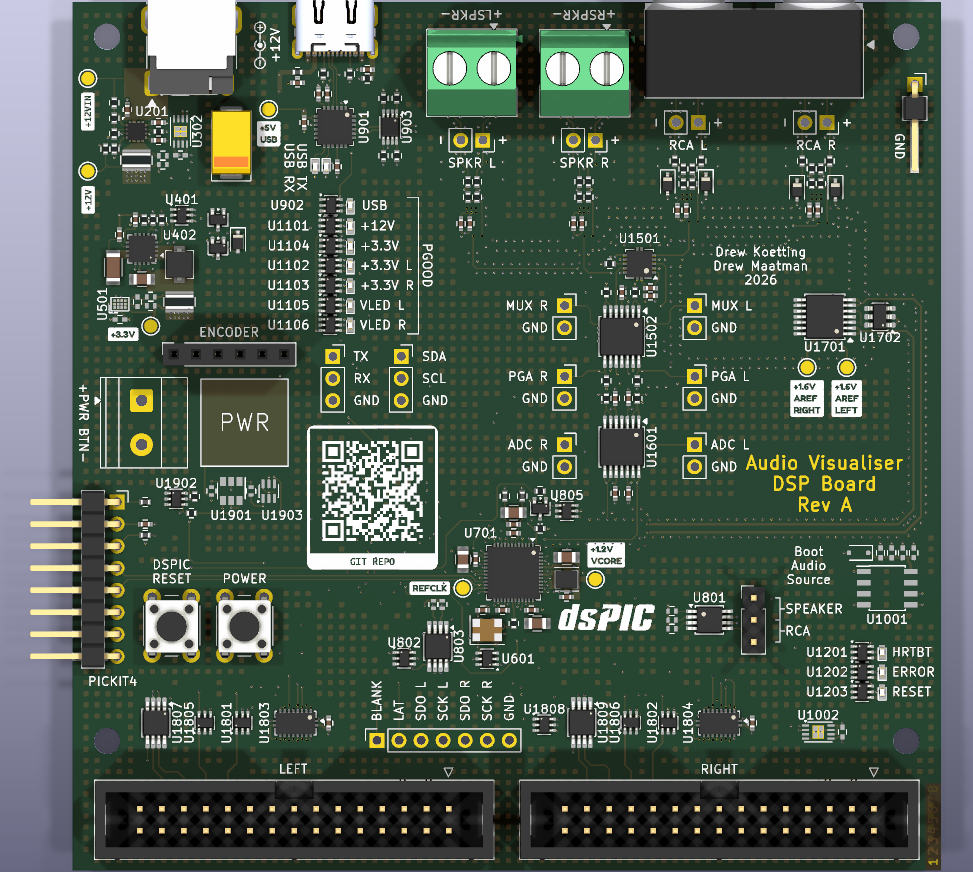

# Audio Visualizer

## Hardware

A graphical EQ display, based on a dsPIC33AK256MPS105 digital signal controller.

### DSP Board:
* Distributes power to LED screens
* Digitizes RCA or speaker level audio signals
* Offsets AC audio signal to +1.6V reference for single-ended ADC conversions
* Adjustable gain or attenuation to fully utilize ADC range
* ~20kHz low-pass active filter for anti-aliasing
* USB Port (virtual COM) for debug and settings
* LED Panel Control

## Continuous integration

GitHub Actions checks every KiCad project under `hdw/` (`.github/workflows/hardware.yml`):

| Job | What it does |
|---|---|
| Repo hygiene | Fails on committed backups, lock files or caches, and on files not saved by KiCad 10.0. Checks that each project's schematic PDF (`<project>.pdf`) is committed and was re-plotted after the last schematic change. |
| ERC / DRC / libraries | Runs ERC, and DRC with schematic parity. Also checks that every symbol and footprint library resolves on a clean machine (project lib tables must use `${KIPRJMOD}`). 
| Visual diff | On every run, renders changed schematic pages and PCB layers against the previous commit or PR base (red = removed, green = added). The result is a single `visual-diff.html` artifact that opens directly in the browser; the run summary links to it. |

